# Pràctica DHCP amb Kea

Guia amb captures de com muntar un servidor DHCP amb **Kea** a Ubuntu i comprovar que funciona amb tres clients: un Ubuntu, un equip amb IP reservada i un Windows.

## Què és DHCP?

DHCP és el servei que reparteix adreces IP automàticament. Quan un equip es connecta a la xarxa, demana una IP al servidor i aquest li respon amb la IP, la porta d’enllaç i els DNS. Així no cal configurar cada equip a mà.

## Esquema de la pràctica

| Màquina | Sistema | Adreça IP | Com la rep |
|---|---|---|---|
| SERVER | Ubuntu Server | 192.168.10.1 | Fixa (és el servidor DHCP) |
| guille-VirtualBox | Ubuntu | 192.168.10.50 | Automàtica (del rang) |
| client xarxa (`impresora-dir`) | Ubuntu | 192.168.10.20 | Reservada per a la seva MAC |
| mvw | Windows | 192.168.10.51 | Automàtica (del rang) |

Totes les màquines són a la mateixa xarxa interna de VirtualBox, anomenada `redDHCP`. La xarxa és `192.168.10.0/24`, el domini és `oficina.local` i els DNS són `1.1.1.1` i `8.8.8.8`.

---

## 1. Servidor: instal·lar i comprovar Kea

### 1.1 Estat de Kea en arrencar

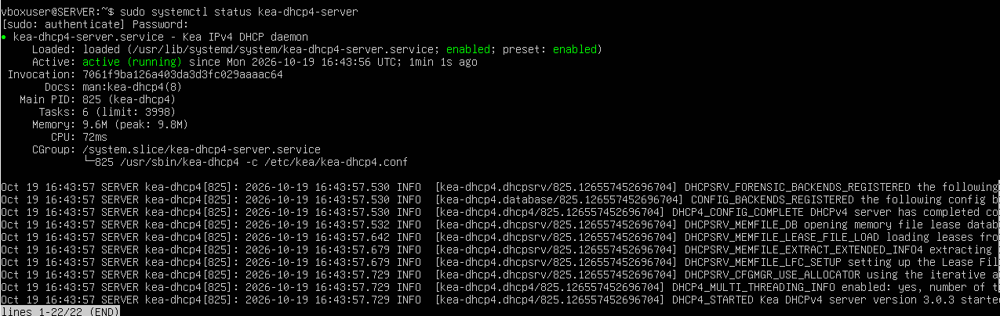

Amb `systemctl status kea-dhcp4-server` es veu que el servei DHCP de Kea està **actiu (running)**. Als missatges del final es llegeix que Kea ha carregat la configuració i s’ha iniciat correctament.

### 1.2 Xarxa del servidor a VirtualBox

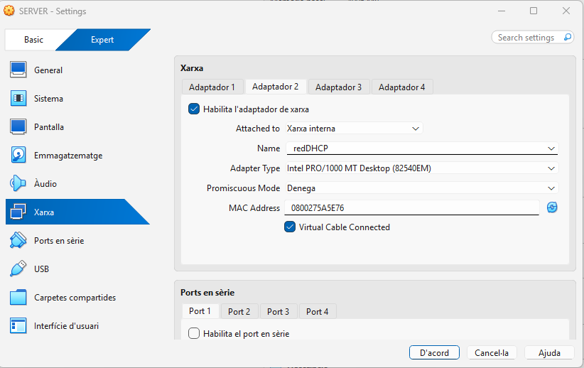

El servidor té un segon adaptador de xarxa connectat a una **xarxa interna** anomenada `redDHCP`. És la xarxa per la qual repartirà les IP als clients.

### 1.3 Paquets instal·lats i servei IPv6 desactivat

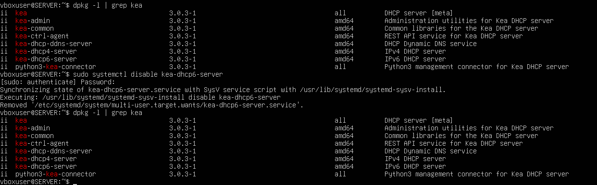

Amb `dpkg -l | grep kea` es comprova quines parts de Kea estan instal·lades. Després es desactiva `kea-dhcp6-server` amb `systemctl disable`, perquè aquesta pràctica només fa servir IPv4 i no cal el servei per a IPv6.

## 2. Servidor: arrencar i aturar el servei

### 2.1 Arrencar i activar el servei

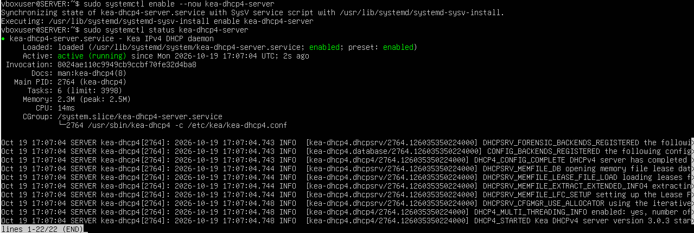

`systemctl enable --now kea-dhcp4-server` fa dues coses: **arrenca** el servei ara i el deixa **activat** perquè s’iniciï sol cada vegada que s’encengui el servidor. Amb `status` es confirma que està en marxa.

### 2.2 Aturar el servei

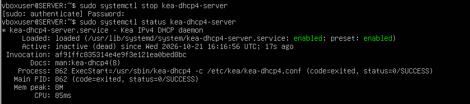

Amb `systemctl stop` s’atura el servei i `status` mostra **inactive (dead)**. Mentre està aturat, cap client nou podria rebre IP.

## 3. Veure com es reparteix una IP (DORA)

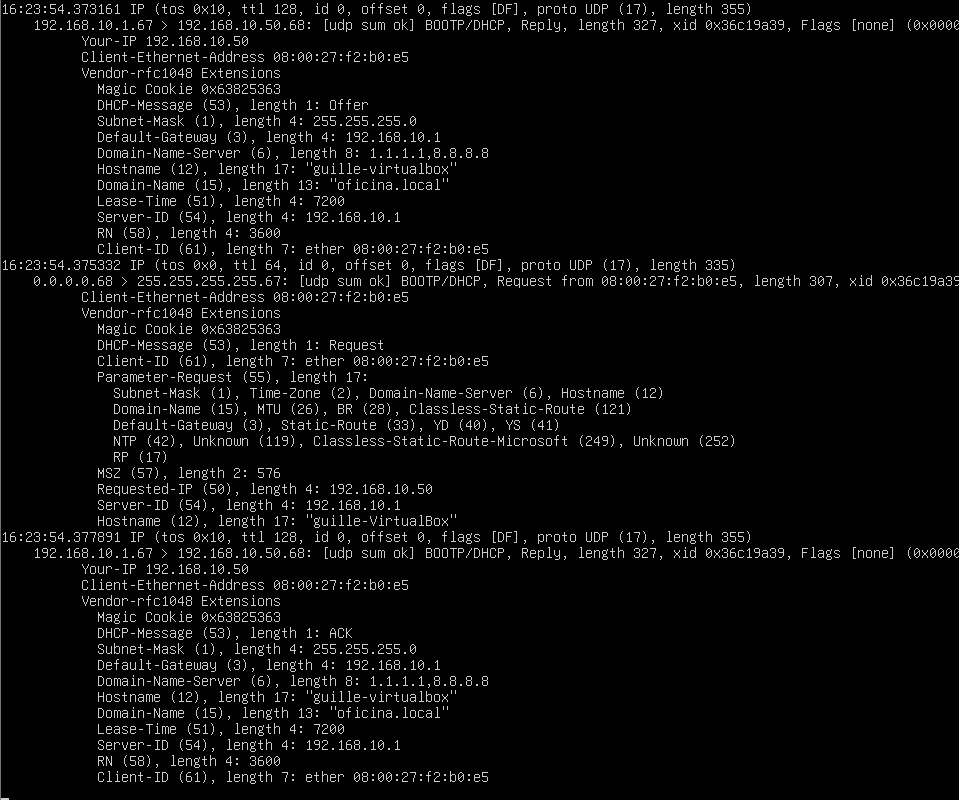

Aquesta captura (feta amb `tcpdump`) mostra la conversa entre client i servidor. Es diu **DORA** per les quatre lletres dels missatges: *Discover*, *Offer*, *Request* i *Acknowledge*. A la imatge es veuen els tres últims:

1. **Offer:** el servidor (`192.168.10.1`) ofereix la IP `192.168.10.50` al client.
2. **Request:** el client respon que vol aquesta IP.
3. **ACK:** el servidor ho confirma.

La resposta inclou la configuració que rep el client: màscara `255.255.255.0`, porta d’enllaç `192.168.10.1`, DNS `1.1.1.1` i `8.8.8.8`, domini `oficina.local` i una concessió de `7200` segons (2 hores).

## 4. Client Ubuntu amb IP automàtica

### 4.1 Demanar una IP nova

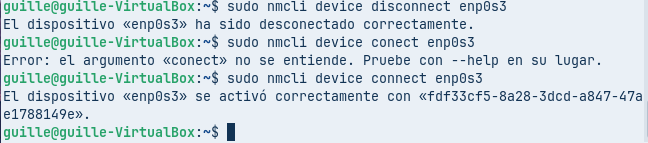

Per forçar que el client demani IP, es desconnecta i es torna a connectar la targeta de xarxa amb `nmcli device disconnect` i `nmcli device connect`. (El primer intent falla perquè es va escriure `conect` en lloc de `connect`.)

### 4.2 IP rebuda

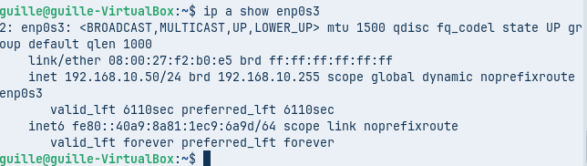

Amb `ip a show enp0s3` es veu que el client ha rebut la IP **192.168.10.50/24**. La paraula `dynamic` indica que li l’ha donada el servidor DHCP.

### 4.3 Porta d’enllaç i DNS

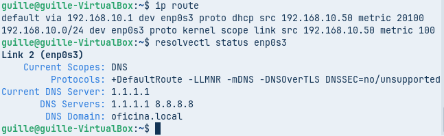

`ip route` mostra que la porta d’enllaç és `192.168.10.1`, apresa per DHCP. `resolvectl status` mostra els DNS `1.1.1.1` i `8.8.8.8` i el domini `oficina.local`. Tot coincideix amb el que va repartir el servidor.

### 4.4 Registre al servidor

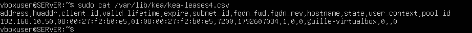

Al servidor, el fitxer `/var/lib/kea/kea-leases4.csv` guarda les IP repartides. Hi apareix la `192.168.10.50` associada a la MAC del client i al seu nom d’equip (`guille-virtualbox`).

## 5. Client amb IP reservada

### 5.1 Xarxa del client a VirtualBox

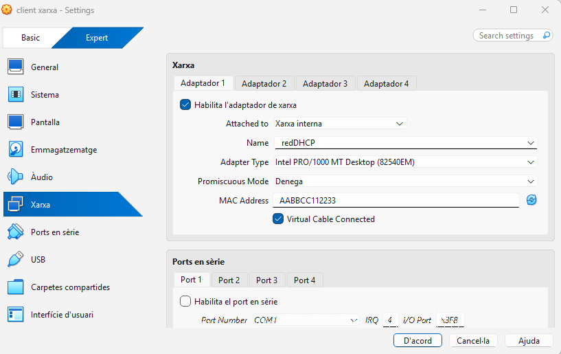

Aquest client també és a la xarxa interna `redDHCP`, però amb una MAC fixada a mà: `AABBCC112233`. Es fa així perquè el servidor la reconegui i li doni sempre la mateixa IP.

### 5.2 IP rebuda

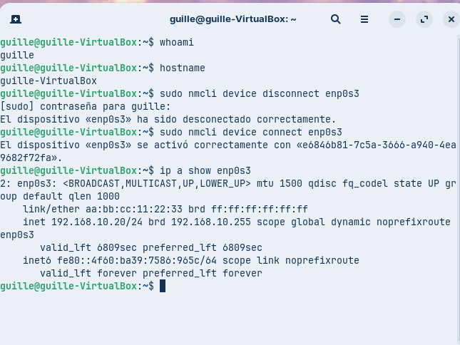

Després de desconnectar i connectar la xarxa, el client rep la IP **192.168.10.20**. És diferent de les del rang automàtic, perquè és una **reserva**: el servidor la guarda per a aquesta MAC.

### 5.3 Registre al servidor

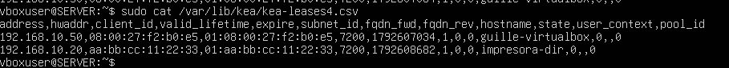

Ara el fitxer de concessions té dues files: la de l’Ubuntu (`192.168.10.50`) i la nova, `192.168.10.20`, amb la MAC `aa:bb:cc:11:22:33` i el nom `impresora-dir`.

## 6. Client Windows

### 6.1 Xarxa del Windows a VirtualBox

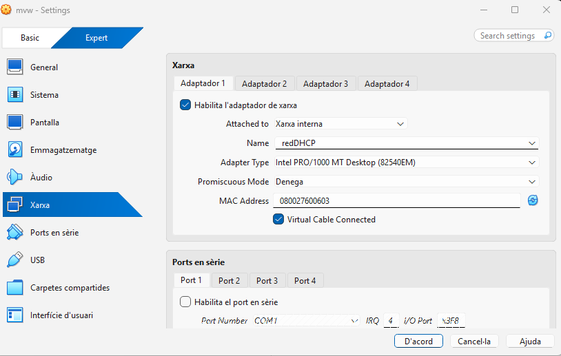

La màquina Windows (`mvw`) també està connectada a la xarxa interna `redDHCP`.

### 6.2 Alliberar i renovar la IP

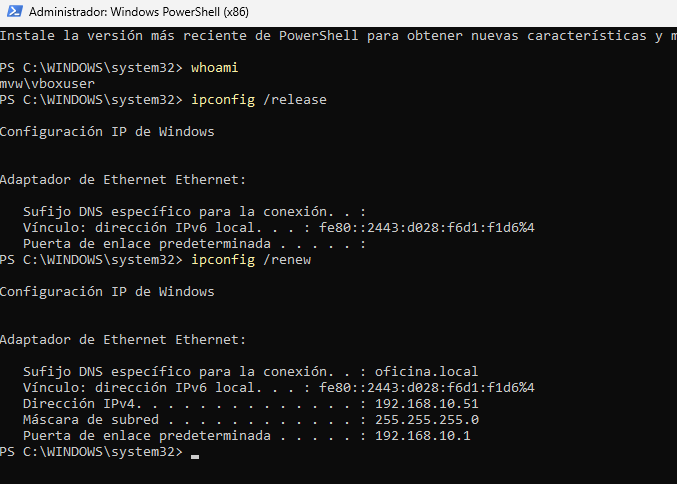

`ipconfig /release` retorna la IP al servidor i l’equip es queda sense adreça. Amb `ipconfig /renew` en demana una de nova i rep **192.168.10.51**, amb màscara `255.255.255.0`, porta d’enllaç `192.168.10.1` i domini `oficina.local`.

### 6.3 Dades completes de la IP

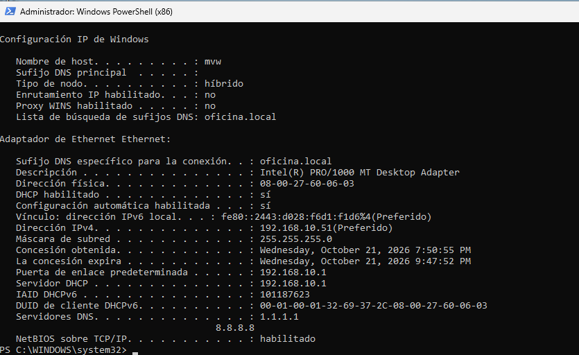

`ipconfig /all` confirma que el DHCP està habilitat i que el servidor que ha donat la IP és `192.168.10.1`. També mostra els DNS (`1.1.1.1` i `8.8.8.8`) i quan s’ha obtingut i quan caduca la concessió (unes 2 hores).

---

## Mapa conceptual

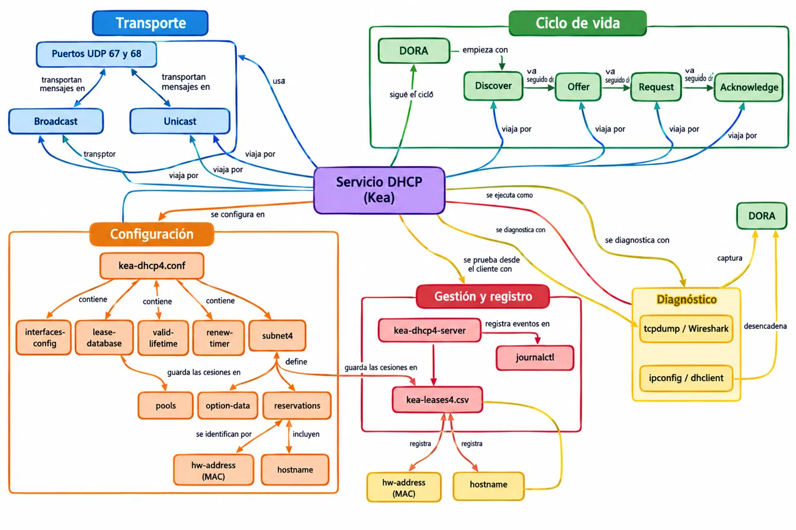

El mapa resumeix el servei DHCP de Kea en cinc blocs:

- **Transport:** els missatges viatgen pels ports UDP 67 i 68, per *broadcast* (a tota la xarxa) o *unicast* (a un equip concret).
- **Cicle de vida:** el procés DORA (*Discover, Offer, Request, Acknowledge*).
- **Configuració:** tot es defineix a `kea-dhcp4.conf`: interfícies, base de dades de concessions, temps, la subxarxa (amb els seus rangs d’IP, opcions i reserves per MAC o nom).
- **Gestió i registre:** el servei guarda els esdeveniments a `journalctl` i les IP repartides a `kea-leases4.csv`.
- **Diagnòstic:** es comprova amb `tcpdump` o Wireshark al servidor i amb `ipconfig` o `dhclient` al client.

## Conclusió

El servidor Kea reparteix IP automàticament a un client Ubuntu (`.50`) i a un Windows (`.51`), i reserva la `.20` per a un equip concret. En tots els casos els clients reben la mateixa configuració de xarxa i el servidor deixa constància de cada concessió.
